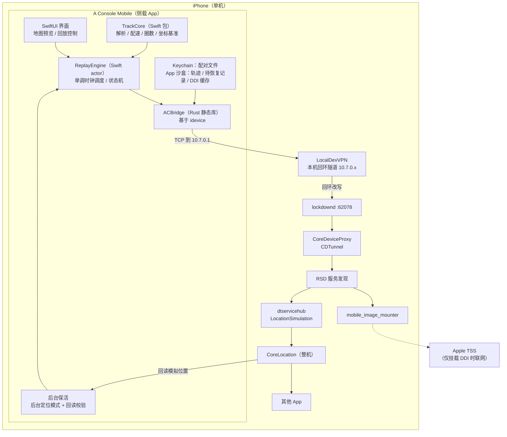
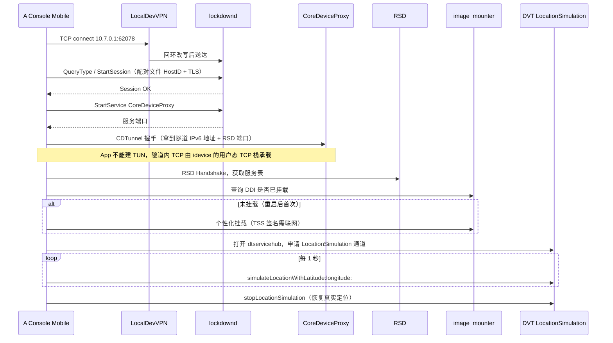
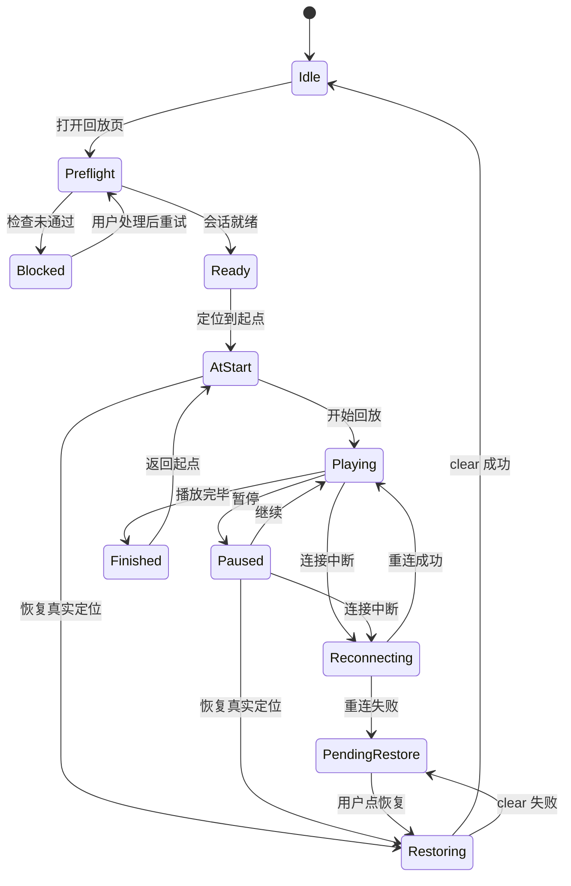
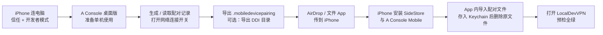

# iOS 单机轨迹回放技术方案（A Console Mobile）

> 记录时间：2026-11-29
> 目标：只用一部 iPhone（iOS 17.4+）完成现在 A Console 桌面版插线才能做的事：导入轨迹、定位到起点、按配速回放、暂停/继续/跳转、恢复真实定位。
> 前身文档：[iOS 定位模拟方案](iOS-定位模拟方案.md)（USB + pymobiledevice3）、[macOS 定位回放控制台方案](macOS-定位回放控制台方案.md)
> 适用范围：自有设备上的定位与轨迹开发测试。

---

## 0. 结论先行

| 问题 | 结论 |
| --- | --- |
| 能不能完全不碰电脑 | **不能**。生成配对文件、首次安装 App 必须连一次电脑。之后日常使用只需要 iPhone。 |
| 底层还是 DVT 定位模拟吗 | **是**。与桌面版走同一个 `com.apple.instruments.server.services.LocationSimulation` 服务，只是「主机」从电脑换成了 iPhone 上的 App 本身。 |
| 要越狱 / 改微信吗 | **不要**。整机 CoreLocation 输出被替换，与桌面版效果一致。 |
| 要 $99 开发者账号吗 | **不强制**。免费 Apple ID + SideStore 可用（7 天自动续签，可在手机上完成）。 |
| 最大的技术风险 | ① 户外无 Wi-Fi 时本机回环能否维持；② App 退后台后推点不能停；③ 锁屏后会话是否保持；④ Apple 后续版本收紧该通道。均需 P0 实测（见 §10）。 |
| 能复用多少现有代码 | 轨迹解析、配速/圈数展开、坐标基准转换（`macos/Sources` 中约 1,000 行纯 Foundation 代码）可直接抽包复用；设备层从 Python 换成 Rust（`idevice`）。 |

---

## 1. 目标与非目标

### 1.1 目标（MVP）

1. 在 iPhone 上导入 GPX / KML / KMZ（文件 App、AirDrop、「用其他应用打开」），并使用内置默认轨迹。
2. 地图预览轨迹、起终点、总距离、预计时长。
3. 坐标基准（WGS-84 / GCJ-02 / BD-09）、配速、圈数 / 目标公里数设置，口径与桌面版一致。
4. 定位到起点 → 开始回放 → 暂停 / 继续 / 拖动跳转 → 结束返回起点 → 恢复真实定位。
5. App 切到后台（用户去用其他 App）时回放不中断。
6. 异常中断（被杀、断开、重启）后，下次打开能识别「待恢复」状态并一键恢复。

### 1.2 非目标

- 不做「零电脑」初始化（技术上不可行，见 §2）。
- 不内置 VPN（免费账号拿不到 Network Extension 权限，见 §6.2）。
- 不支持 iOS 17.0–17.3（缺少 lockdown 侧的 CoreDeviceProxy，见 §2）。
- 不做任何针对特定应用检测逻辑的规避处理。

---

## 2. 前置条件与硬性限制

| 条件 | 说明 | 何时需要 |
| --- | --- | --- |
| iOS 17.4 或以上 | 17.4 起 lockdownd 提供 `com.apple.internal.devicecompute.CoreDeviceProxy`，可以不经 RemoteXPC 配对直接建隧道。17.0–17.3 只能走 RemoteXPC 配对，单机方案不支持。 | 一直 |
| 开发者模式 | 设置 → 隐私与安全性 → 开发者模式。 | 一直 |
| 配对文件 | 电脑与 iPhone 的 lockdown 配对记录（HostID、HostCertificate、HostPrivateKey、RootCertificate、SystemBUID 等），等价于「受信任电脑」凭证。 | **首次连电脑生成**；手机执行「还原位置与隐私」或换机后需重新生成 |
| 安装 App | 侧载自签 IPA（SideStore / 付费账号 / 企业证书三选一）。 | **首次连电脑**；之后续签可在手机上完成 |
| LocalDevVPN | App Store 免费应用，提供本机回环隧道。 | 每次使用时打开 |
| Wi-Fi 接口 | 社区反馈本机 lockdown 连接依赖已关联的 Wi-Fi 接口；纯蜂窝下可能失败，有「飞行模式」绕行的反馈。**我们尚未实测**。 | 待 P0 确认 |
| 开发者磁盘镜像（DDI） | iOS 17+ 为个性化镜像，挂载时需要向 Apple TSS 服务器签名，**需要联网**（蜂窝即可）。挂载状态保持到下次重启。 | 每次重启手机后的首次使用 |

---

## 3. 总体架构



**与桌面版的映射关系：**

| 桌面版（现有） | 单机版（新） |
| --- | --- |
| Mac / Windows 主机 | iPhone 上的 A Console Mobile |
| USB 数据线 + usbmuxd | LocalDevVPN 本机回环 + TCP |
| 系统里的配对记录 | 导入到 App Keychain 的配对文件 |
| `pymobiledevice3`（Python） | `idevice`（Rust，静态链接进 App） |
| `device_bridge.py` 的 JSON Lines | `ACBridge` 的 C 接口 |
| `ConsoleModel.swift`（AppKit） | `ReplayEngine` + SwiftUI（UIKit 平台） |

---

## 4. 核心链路详解

### 4.1 为什么 App 能「自己当电脑」

iOS 的开发者服务原本只对受信任主机开放，受信任的判据是 **lockdown 配对记录**，而不是「连接是否来自 USB」。lockdownd 同时在网络接口上监听 62078 端口（这就是 Wi-Fi 同步 / 无线调试的入口）。所以只要满足两点，App 就能以主机身份连上自己：

1. **持有配对记录**：用记录里的 HostID 和证书完成 lockdown `StartSession` + TLS。
2. **网络可达**：App 直接连 `127.0.0.1` 不会被当成网络主机，需要一个 VPN 扩展把发往虚拟地址（如 `10.7.0.1`）的包改写后送回本机，看起来像从外部到达的连接。LocalDevVPN 只做这件事，不出设备。

### 4.2 连接时序



### 4.3 配对文件

| 项 | 说明 |
| --- | --- |
| 格式 | XML plist，常见扩展名 `.mobiledevicepairing` / `.plist` |
| 内容 | `HostID`、`SystemBUID`、`HostCertificate`、`HostPrivateKey`、`DeviceCertificate`、`RootCertificate`、`RootPrivateKey`、`WiFiMACAddress` 等 |
| 生成方式 | 推荐由**桌面版 A Console 新增「导出 iPhone 配对文件」**（内置 pymobiledevice3 已具备配对能力，见 §7）；也可用 jitterbugpair / iloader 等第三方工具 |
| 网络连接开关 | 需确认是否要打开 `com.apple.mobile.wireless_lockdown` 域的 `EnableWifiConnections`（对应 `pymobiledevice3 lockdown wifi-connections --state on`）。导出流程里一并设置，**是否必需以 P0 实测为准** |
| 失效条件 | 手机「还原位置与隐私」、抹掉设备、在电脑上取消配对、换机 |

### 4.4 开发者磁盘镜像（DDI）

- iOS 17+ 使用个性化 DDI：`BuildManifest.plist` + `Image.dmg` + `Image.dmg.trustcache`（与 Xcode `DeveloperDiskImages/iOS_DDI/Restore` 目录一致，桌面版 `A_CONSOLE_DDI_RESTORE_DIR` 用的就是这个结构）。
- 挂载时 App 向 Apple TSS（`gs.apple.com`）提交设备 ECID 与 nonce 换取签名，**必须联网**。
- 镜像文件来源（按优先级）：
  1. 设备上已挂载 → 直接用，不联网。
  2. App 沙盒缓存（首次从桌面版导出或用户经 AirDrop 导入，校验 SHA-256）。
  3. 在线下载（来源固定、校验 SHA-256，写进构建配置，不允许运行时任意 URL）。
- 挂载状态持续到重启。App 启动时先查询，避免重复挂载。

### 4.5 会话保持

| 机制 | 作用 |
| --- | --- |
| lockdown heartbeat（`com.apple.mobile.heartbeat`） | 网络方式连接的 lockdown 需要周期性心跳，否则设备会断开主机。Bridge 内部起独立任务维持。 |
| DVT 写入间隔 | 回放时 1 Hz 写入本身就是活动；暂停时每 5 秒重写一次当前点作为保活。 |
| 断线重连 | 任一层出错 → 指数退避（1s / 2s / 4s，上限 15s）→ 重建 lockdown → 隧道 → DVT → 从中断点继续，与桌面版 `device_bridge.py` 的 `reconnect` 语义一致。 |

---

## 5. App 设计

### 5.1 模块划分

| 模块 | 语言 | 职责 | 来源 |
| --- | --- | --- | --- |
| `TrackCore` | Swift Package | GPX/KML/KMZ 解析、配速展开、圈数 / 公里数、单圈中线、坐标基准、`ReplayTimeline` | **从 `macos/Sources/UnRealConsole` 抽出**，macOS 版同时改为依赖它 |
| `ACBridge` | Rust → `.xcframework` | lockdown / 隧道 / RSD / DDI / DVT / 心跳，暴露约 8 个 C 函数 | 新写，依赖 `idevice`（MIT） |
| `DeviceSession` | Swift actor | 包装 C 接口，串行化调用，转换错误，重连策略 | 新写 |
| `ReplayEngine` | Swift actor | 单调时钟调度、暂停/跳转、进度、待恢复记录 | 逻辑对齐 `ConsoleModel` + `device_bridge.py replay()` |
| `KeepAlive` | Swift | 后台定位模式、回读校验、低电量提示 | 新写 |
| `Preflight` | Swift | 启动前逐项检查并给出处理提示 | 新写 |
| UI | SwiftUI + MapKit | 轨迹页、回放页、设置页、引导页 | 参照桌面版布局重写 |

### 5.2 代码复用：抽出 `TrackCore`

现有 Swift 源码中，以下文件只依赖 Foundation / simd，可原样移入共享包：

| 文件 | 行数 | 处理 |
| --- | --- | --- |
| `Route.swift`（`TrackRoute`、`TrackPoint`、`ReplayPace`、`ReplayTimeline`、`CalibrationOffset`） | 219 | 原样移入 |
| `KMLRoute.swift` | 243 | **需改造**：KMZ 解压目前调用 `/usr/bin/unzip`（`Process`），iOS 不可用。换成基于 Compression 框架 / zlib 的最小 ZIP 读取器（只需中央目录 + deflate/stored），保留现有 2 MB 列表上限与 XML 大小上限 |
| `LoopRoute.swift` | 70 | 原样移入 |
| `TrackMetrics.swift` | 217 | 原样移入 |
| `CoordinateTransform.swift` | 159 | 原样移入 |
| `TrackSource.swift` | 21 | 原样移入 |
| `ConsoleModel.swift` | 795 | 依赖 AppKit 和 Python 子进程，**不复用**；把其中与平台无关的设置联动（圈数、配速、长度模式）拆成 `ReplayPlan` 值类型放进 `TrackCore` |

对应的 `Tests/UnRealConsoleTests` 中轨迹、时间线、坐标转换相关测试随包迁移，两个平台共用，保证回放口径一致。

### 5.3 `ACBridge` C 接口

Rust 侧只暴露业务需要的最小面，避免把整个 `idevice` FFI 带进 Swift：

```c
// ac_bridge.h
typedef struct ac_session ac_session;

typedef enum {
    AC_OK = 0,
    AC_ERR_UNREACHABLE,   // 10.7.0.1:62078 连不上：VPN 未开 / 无 Wi-Fi
    AC_ERR_PAIRING,       // 配对文件无效或已被撤销
    AC_ERR_DEV_MODE,      // 开发者模式未开启
    AC_ERR_DDI,           // 镜像缺失 / TSS 失败
    AC_ERR_TUNNEL,        // CoreDeviceProxy / RSD 失败
    AC_ERR_DVT,           // 定位模拟通道失败
    AC_ERR_TIMEOUT,
} ac_status;

typedef struct {
    char product_version[16];   // 如 "18.2"
    char device_name[64];
    bool developer_mode;
    bool ddi_mounted;
} ac_device_info;

ac_status ac_session_open(const char *host_ip, uint16_t port,
                          const uint8_t *pairing_plist, size_t pairing_len,
                          uint32_t timeout_ms, ac_session **out);
ac_status ac_device_info_get(ac_session *s, ac_device_info *out);
ac_status ac_ddi_mount(ac_session *s, const char *restore_dir, uint32_t timeout_ms);
ac_status ac_location_open(ac_session *s);
ac_status ac_location_set(ac_session *s, double lat, double lon);  // WGS-84
ac_status ac_location_clear(ac_session *s);
ac_status ac_session_ping(ac_session *s);
void      ac_session_close(ac_session *s);
const char *ac_last_error(void);   // 线程局部，供 UI 展示
```

实现要点：

- 进程内一个 tokio 运行时；C 函数内部 `block_on`，Swift 侧只在 `DeviceSession` actor 的后台执行器上调用，**绝不在主线程调用**。
- 使用 `idevice` 的 lockdown、pairing、core_device_proxy、用户态 TCP 隧道、rsd、mobile_image_mounter、tss、dvt、location_simulation、heartbeat 等能力；具体 Cargo feature 名称以锁定版本为准，版本写死在 `Cargo.lock`，与桌面版固定 `pymobiledevice3` 版本的做法一致。
- 构建：`cargo build --target aarch64-apple-ios --release` → `xcodebuild -create-xcframework`。真机只需 `aarch64-apple-ios`；如需在模拟器跑 UI，再加 `aarch64-apple-ios-sim`（模拟器上设备层直接返回 `AC_ERR_UNREACHABLE`）。
- 同一套 Rust 代码可编译成 macOS 命令行工具，**先在 Mac 上经 USB 验证 API 行为**，再上真机单机链路（见 §11 P1）。

### 5.4 回放调度

与桌面版保持同一套语义（`ReplayTimeline.build` + 按相对时间推进）：

1. 开始时记下 `t0 = ContinuousClock.now` 和起始索引；每个 tick 用 `elapsed = now - t0 + 已回放偏移` 求目标索引，**不累加 sleep 误差**。
2. tick 间隔 1 秒；若上一次 `ac_location_set` 尚未返回，本 tick 跳过写入（合并），避免积压。
3. 进度以「已确认写入」的点为准，UI 显示与实际推送一致。
4. 暂停：保留当前点，每 5 秒重写一次；继续：以暂停点为新起点重建 `t0`。
5. 跳转：取最接近的时间线采样点，立即写入一次。
6. 正常结束：写回轨迹起点（与桌面版行为一致）；用户点「恢复真实定位」才发 `clear`。
7. 坐标统一按设置的「坐标基准」归一为 WGS-84 后写入。

### 5.5 状态机



`PendingRestore` 持久化到沙盒（含写入过模拟位置的时间戳），App 被杀或重启后启动时读回。

### 5.6 后台保活

这是单机版与桌面版差异最大的地方：桌面版的推送进程在电脑上，不受 iOS 调度；单机版的推送者就是 App 自己，**一旦被挂起，推点就停**。

| 方案 | 机制 | 优点 | 缺点 | 结论 |
| --- | --- | --- | --- | --- |
| **A 后台定位模式** | `UIBackgroundModes: location`；开始回放时（前台）`CLLocationManager.startUpdatingLocation()`，`allowsBackgroundLocationUpdates = true`，`pausesLocationUpdatesAutomatically = false` | 持续运行时间不受限；无需特殊权限（侧载无需审核）；**顺带拿到模拟后的位置做回读校验** | 状态栏常驻定位指示；耗电略增 | **主方案** |
| B 静音音频 | `UIBackgroundModes: audio`，`AVAudioSession(.playback, .mixWithOthers)` 循环播放静音 | 实现简单 | 来电、其他 App 播放音频时被打断 | 备用，A 被系统暂停时自动切换 |
| C 画中画 | `AVPictureInPictureController` + `AVSampleBufferDisplayLayer` 自绘进度帧（需配合 B） | 后台时可见进度 | 实现复杂；依赖音频模式 | 可选的展示层，P4 再做 |
| D 实时活动 | ActivityKit + 灵动岛 / 锁屏显示进度 | 展示好 | **不提供保活**；多一个扩展（占免费账号 App ID 配额） | 可选的展示层，P4 再做 |

**回读校验**：方案 A 收到的 `CLLocation` 正是模拟后的位置。每次回读与最近写入点比较，距离 < 15 m 记为「注入生效」，连续 10 秒偏离则在 UI 告警。这同时解决了桌面版「发送成功 ≠ 手机生效」的确认问题。

**限制提醒**：用户在多任务界面上划掉 App = 推点立即停止，位置会停在最后一点。UI 需在开始回放前明确提示，并依靠 `PendingRestore` 兜底。

### 5.7 预检（Preflight）

| 检查项 | 方法 | 失败提示 |
| --- | --- | --- |
| iOS 版本 ≥ 17.4 | `UIDevice.current.systemVersion` | 不支持，建议用桌面版 |
| Wi-Fi 接口 | `NWPathMonitor` 是否有 `.wifi` 接口 | 连接 Wi-Fi 或热点 |
| 回环可达 | TCP 连接 `10.7.0.1:62078`，2 秒超时（App 读不到第三方 VPN 状态，只能探测） | 打开 LocalDevVPN |
| 配对文件 | Keychain 中存在且 `StartSession` 成功 | 重新导入配对文件 |
| 开发者模式 | lockdown 查询 `DeveloperModeStatus` | 打开开发者模式并重启 |
| DDI | image_mounter 查询；未挂载则检查网络后挂载 | 联网后重试 |
| 定位权限 | `CLLocationManager.authorizationStatus` | 授权「使用 App 期间」及以上 |
| 低电量模式 | `ProcessInfo.isLowPowerModeEnabled` | 提示可能影响后台运行 |
| 未完成恢复 | 读 `PendingRestore` | 先恢复真实定位 |

### 5.8 界面

| 页面 | 内容 |
| --- | --- |
| 引导 | 三步：导入配对文件 → 安装并打开 LocalDevVPN → 预检全绿 |
| 轨迹 | 内置轨迹 / 导入；地图折线、起终点；点数、距离、预计时长 |
| 回放 | 坐标基准、配速、圈数 / 公里数；「定位到起点」「开始」「暂停 / 继续」时间条、当前圈；「恢复真实定位」 |
| 状态条 | 连接状态、回读校验结果、后台保活状态、最近错误 |
| 设置 | 回环地址（默认 `10.7.0.1`，可改）、配对文件管理（替换 / 删除）、DDI 缓存、日志导出（已脱敏） |

**地图显示注意**：中国大陆境内 MapKit 底图为 GCJ-02。轨迹统一以 WGS-84 存储与推送，**绘制到 MapKit 前转换为 GCJ-02**（复用 `CoordinateTransform.wgs84ToGCJ02`，境外坐标不转），否则预览会整体偏移数百米。

---

## 6. 安装与分发

### 6.1 签名方式对比

| 方式 | 费用 | 有效期 | 续签 | 能否单机 | 适合 |
| --- | --- | --- | --- | --- | --- |
| 免费 Apple ID + SideStore | 0 | 7 天 | SideStore 在手机上续签（同样依赖 LocalDevVPN + 配对文件） | ✅ | 个人默认方案 |
| 付费开发者账号 | $99/年 | 1 年 | 每年重签一次 | ✅ | 长期使用 / 多台测试机（需登记 UDID） |
| AltStore 经典版 | 0 | 7 天 | 需电脑上的 AltServer | ❌ | 不推荐 |

### 6.2 免费账号的约束（影响设计）

- 同时最多 3 个侧载 App（SideStore 自身占 1 个）。
- 每 7 天最多注册 10 个 App ID，**App 扩展各占一个**：MVP 不带扩展，实时活动、小组件放到可选阶段。
- 不能使用 Network Extension 权限 → 不能自带 VPN，必须依赖 App Store 上的 LocalDevVPN。
- `UIBackgroundModes`（location / audio）只是 Info.plist 声明，不需要额外权限，免费账号可用。

### 6.3 构建与发布

1. GitHub Actions（macOS runner）：构建 `ACBridge.xcframework` → `xcodebuild archive CODE_SIGNING_ALLOWED=NO` → 打包 `Payload/A Console Mobile.app` 为未签名 IPA。
2. 产出 IPA 与 SHA-256，按现有[双平台发布流程](desktop-release.md)上传 GitHub 与 Gitee。
3. 提供 SideStore 源 JSON（`apps.json`），用户添加源后可在手机上接收更新。
4. 版本号沿用仓库根目录 `VERSION` 的递增规则，单独加 `ios-v*` 标签。

---

## 7. 首次初始化流程（唯一需要电脑的一次）

桌面版 A Console 已内置 pymobiledevice3 和 USB 连接，新增一个「准备单机使用」向导即可把电脑侧步骤收敛为一次点击：



桌面版改动（macOS `device_bridge.py` 与 Windows `windows/` 共用）：

| 操作 | 实现 |
| --- | --- |
| 生成配对记录 | 复用 pymobiledevice3 的 lockdown 配对；已配对则读取现有记录 |
| 打开网络连接 | 设置 `wireless_lockdown/EnableWifiConnections = true` |
| 导出 | 写到用户选择的位置，文件权限 600，导出后提示「此文件等同于电脑信任凭证」 |
| DDI | 复用现有 `A_CONSOLE_DDI_RESTORE_DIR` 逻辑，打包为 zip 一并导出（可选） |

---

## 8. 安全设计

配对文件可以让持有者以「受信任电脑」身份访问这台 iPhone 的 lockdown 服务（读取设备信息、媒体文件访问、安装应用等），**必须当作密钥对待**。

| 项 | 措施 |
| --- | --- |
| 存储 | 导入后立即写入 Keychain（`kSecAttrAccessibleAfterFirstUnlockThisDeviceOnly`，后台需要读取所以不能用 WhenUnlocked），不进 iCloud / 备份；随后删除 App 沙盒内的明文副本 |
| 传输 | 只建议 AirDrop / 本地文件 App；不提供任何上传、云同步功能 |
| 日志 | 日志中不输出 HostID、证书、私钥、UDID 全量（UDID 仅保留后 4 位） |
| 网络 | 设备层只连回环地址；联网只发生在 DDI 的 TSS 签名与（可选）固定来源的 DDI 下载，地址写死在构建配置 |
| 第三方组件 | `idevice` 锁定版本并在升级时审阅变更；LocalDevVPN 仅做本机回环，使用前核对其隐私说明 |
| 撤销 | 引导页写明撤销方式：设置 → 通用 → 传输或还原 iPhone → 还原 → 还原位置与隐私（会使所有电脑配对失效） |

---

## 9. 风险与未知项

| # | 风险 | 影响 | 验证方法 | 应对 |
| --- | --- | --- | --- | --- |
| R1 | 无 Wi-Fi 时回环不可用 | 户外无法使用 | P0：家用 Wi-Fi / 另一部手机热点 / 纯蜂窝 / 飞行模式 + 关 Wi-Fi 各测一次 | 若必须 Wi-Fi：引导中写明需热点；随身 Wi-Fi 或同伴热点 |
| R2 | 后台被挂起 | 推点中断 | P0：回放中切到其他 App 30 / 60 分钟，记录写入日志是否连续 | 方案 A 失败则叠加方案 B；仍失败则要求回放期间 App 保持前台 |
| R3 | 锁屏后 lockdown 会话断开 | 推点中断 | P0：回放中锁屏 1 / 5 / 15 分钟 | 文档要求回放期间保持亮屏；重连逻辑兜底 |
| R4 | 会话断开时定位是否自动恢复 | 影响「待恢复」逻辑 | P0：回放中关闭 LocalDevVPN，观察系统地图 | 两种行为都要处理：自动恢复则标记已恢复；卡住则走 `PendingRestore`，最终兜底为重启手机 |
| R5 | 重启后 DDI 需重新挂载且需联网 | 无网时无法开始 | P0：重启后在纯蜂窝下首次使用 | 预检提前提示；出门前先挂载一次 |
| R6 | Apple 收紧该通道（网络 lockdown、CoreDeviceProxy、DDI 策略） | 方案整体失效 | 每个 iOS 大版本 / 首个 beta 回归测试 | 保留桌面版 USB 方案作为回退；README 标注已验证的 iOS 版本 |
| R7 | 免费账号 7 天过期未续签 | App 打不开 | — | SideStore 后台续签 + App 内到期提醒 |
| R8 | `idevice` API 变动 | 构建失败 | CI 锁定版本 | 升级时跑 Mac 侧 USB 集成测试再合入 |
| R9 | 配对文件泄露 | 设备被他人以受信任主机身份访问 | — | 见 §8；泄露后立即「还原位置与隐私」 |

---

## 10. 验证计划

### 10.1 P0：零代码可行性验证（先做，半天）

不写任何代码，用现成开源工具在目标 iPhone 上验证链路本身：

1. 桌面版（或 pymobiledevice3）生成配对文件，打开网络连接开关。
2. iPhone 安装 SideStore → 用它安装 StikDebug（其中自带定位模拟功能，同样基于 `idevice`）。
3. App Store 安装 LocalDevVPN 并打开，StikDebug 导入配对文件，等待 DDI 挂载。
4. 在 StikDebug 中设置一个与真实位置明显不同的点，打开系统「地图」确认蓝点跳转。
5. 按 §9 的 R1 / R3 / R4 / R5 逐项记录（R2 需要连续推点，留到 P2 用自己的 App 验证）。

**判据：**

| 结果 | 结论 |
| --- | --- |
| 地图蓝点跳转，R1 至少「热点」可用 | ✅ 进入 P1 |
| 蓝点跳转，但只有家用 Wi-Fi 可用 | ⚠️ 可做，但需在文档中明确户外限制，与使用者确认是否接受 |
| 蓝点不动 / 配对或 DDI 失败 | ❌ 先排查 iOS 版本、开发者模式、配对文件；仍失败则停止，继续用桌面版 |

### 10.2 自动化测试

| 层 | 内容 | 运行环境 |
| --- | --- | --- |
| `TrackCore` 单元测试 | 迁移现有轨迹 / 时间线 / 坐标 / 圈数测试；新增 ZIP 读取器测试（stored、deflate、超限、路径穿越） | `swift test`（macOS 与 iOS 模拟器） |
| `ReplayEngine` 单元测试 | 用假的 `DeviceSession` 验证 tick 合并、暂停 / 继续 / 跳转、重连续播、`PendingRestore` 持久化 | iOS 模拟器 |
| `ACBridge` 集成测试 | Mac 上编译为 CLI，经 USB 跑：枚举 → 隧道 → set → clear | 本机 + 真机 |

### 10.3 真机验收清单

记录 iPhone 型号、iOS 版本、LocalDevVPN 版本、App 版本，逐项填写：

- [ ] 首次导入配对文件、预检全绿
- [ ] 重启后 DDI 自动挂载
- [ ] 定位到起点，系统地图确认
- [ ] 20 秒样例轨迹（`macos/Tests/Fixtures/sample.gpx`）完整回放，回读校验全程「生效」
- [ ] GPX / KML / KMZ 三种格式
- [ ] 暂停、继续、拖动跳转、修改圈数后继续
- [ ] 回放中切到其他 App 30 分钟不中断
- [ ] 回放中锁屏（按 R3 结论）
- [ ] 关闭 LocalDevVPN → 重连 / 待恢复
- [ ] 从多任务界面划掉 App → 重新打开后提示恢复
- [ ] 恢复真实定位后系统地图回到真实位置
- [ ] 热点 / 纯蜂窝（按 R1 结论）

---

## 11. 排期

| 阶段 | 内容 | 产出 | 工作量 |
| --- | --- | --- | --- |
| P0 | 零代码可行性验证 | §10.1 记录表 | 0.5 天 |
| P1 | 抽 `TrackCore`（含 ZIP 读取器）；macOS 版改为依赖它；`ACBridge` Rust 库 + Mac CLI 经 USB 验证 | 共享包 + 桥接库，桌面版回归通过 | 3 天 |
| P2 | iOS App MVP：引导、导入、预览、定位到起点、回放、暂停、恢复；后台定位保活 + 回读校验 | 可侧载 IPA | 4 天 |
| P3 | 健壮性：预检、重连、`PendingRestore`、DDI 缓存、日志脱敏 | 通过 §10.3 清单 | 2–3 天 |
| P4 | 桌面版「准备单机使用」向导；可选：画中画 / 实时活动 | 一键初始化 | 2 天 |
| P5 | CI 出 IPA、SideStore 源、文档与 README 更新 | `ios-v0.1.0` | 1 天 |

P0 不通过则在 P0 结束，不进入后续阶段。

---

## 12. 目录规划

```
shared/
  TrackCore/                    Swift Package（macOS 与 iOS 共用）
    Sources/TrackCore/          Route、KMLRoute、ZipReader、LoopRoute、TrackMetrics、CoordinateTransform、ReplayPlan
    Tests/TrackCoreTests/
ios/
  project.yml                   XcodeGen 工程描述（避免提交 .xcodeproj 冲突）
  AConsoleMobile/
    App/                        入口、引导
    Replay/                     ReplayEngine、状态机、PendingRestore
    Device/                     DeviceSession（Swift 包装）、Preflight
    KeepAlive/                  后台定位、回读校验、音频备用
    UI/                         轨迹页、回放页、设置页
    Resources/                  默认轨迹、Info.plist
  bridge/                       Rust crate（ACBridge），Cargo.lock 锁版本
    include/ac_bridge.h
    src/
    build-xcframework.sh
  Tests/
macos/                          改为依赖 shared/TrackCore
windows/                        新增配对文件导出
```

---

## 13. 参考

| 项目 | 用途 |
| --- | --- |
| [jkcoxson/idevice](https://github.com/jkcoxson/idevice) | Rust 实现的 iOS 设备协议栈（lockdown、CoreDeviceProxy、RSD、DVT、LocationSimulation），本方案设备层依赖，MIT |
| StikDebug | 基于 `idevice` 的单机调试工具，含定位模拟，P0 验证用 |
| SideStore | 免费账号单机侧载与续签 |
| LocalDevVPN | App Store 上的本机回环隧道 |
| [doronz88/pymobiledevice3](https://github.com/doronz88/pymobiledevice3) | 桌面版现有设备层，用于生成 / 导出配对文件 |
